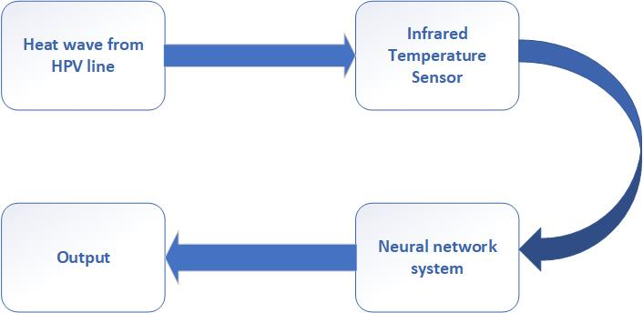

# Transmission-Line-Currents

A comparison of artificial intelligence and machine-learning models for estimating current in electrical transmission lines.

[](https://doi.org/10.56220/uwjst.v6i0.71)
[](https://github.com/haseebjaved123/TransCurrents_UWJST_2022)



## What it is

A comparison of artificial intelligence and machine-learning models for estimating current in electrical transmission lines. Venue: University of Wah Journal of Science and Technology, vol. 6, pp. 45–53, 2022.

## Why it matters

The paper is part of the published record on energy systems. This repository records the bibliographic facts and the figure used on the project site. It does not add unpublished measurements.

## Citation

```bibtex
@article{javed2022transmission,
  title={A Comparative Analysis of Artificial Intelligence and Machine Learning Approach to Estimate Currents in Electrical Power Transmission Lines},
  author={Javed, Haseeb and Pansota, Muhammad Shahzad and Khan, Hamza Ali and Rehman, Ali},
  journal={University of Wah Journal of Science and Technology},
  year={2022},
  doi={10.56220/uwjst.v6i0.71}
}
```

## License

MIT for notes and helper code in this repository. The article remains with its publisher.
